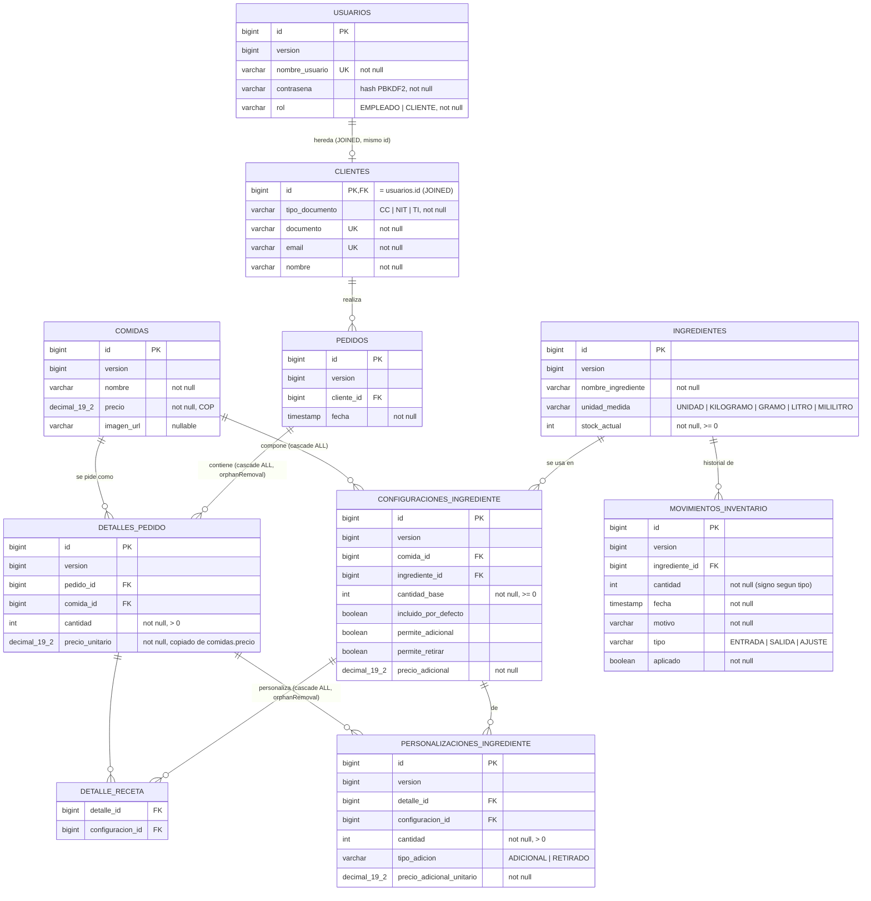

# Diagrama Entidad-Relacion

Generado a partir del modelo JPA implementado en `backend/src/main/java/com/gfc/domain/model`.
Refleja las tablas que Hibernate crea hoy en H2 (unica base de datos del proyecto).

## Notas del mapeo

- **Herencia `USUARIOS` / `CLIENTES`**: estrategia `InheritanceType.JOINED`. Cada `Cliente` es una fila en `usuarios` (con `rol = CLIENTE`) mas una fila en `clientes` que comparte la misma clave primaria. Hoy no existen empleados persistidos como subtipo: `Rol.EMPLEADO` existe en el enumerado pero no tiene una tabla propia todavia.
- **`DETALLE_RECETA`**: tabla intermedia de la relacion `@ManyToMany` entre `DetallePedido` y `ConfiguracionIngrediente`. Guarda una copia congelada de la receta vigente de la comida al momento de crear el detalle; no se actualiza si la comida cambia despues.
- **Cascada y borrado huerfano**: `pedidos -> detalles_pedido` y `detalles_pedido -> personalizaciones_ingrediente` usan `orphanRemoval = true` (al quitar un hijo de la coleccion en memoria, se borra su fila). `comidas -> configuraciones_ingrediente` usa cascada `ALL` pero sin `orphanRemoval`.
- **Restricciones unicas**: `usuarios.nombre_usuario`, `clientes.documento`, `clientes.email`, `(comida_id, ingrediente_id)` en `configuraciones_ingrediente` y `(detalle_id, configuracion_id)` en `personalizaciones_ingrediente`.
- **Bloqueo optimista**: toda tabla hereda `version` de `BaseEntity` (`@Version`) para detectar escrituras concurrentes.
- **Motor de base de datos**: unicamente H2, persistido en archivo (`jdbc:h2:file:./data/gfcdb`), ver `backend/src/main/resources/application.yml`. El soporte a PostgreSQL fue retirado del proyecto.
