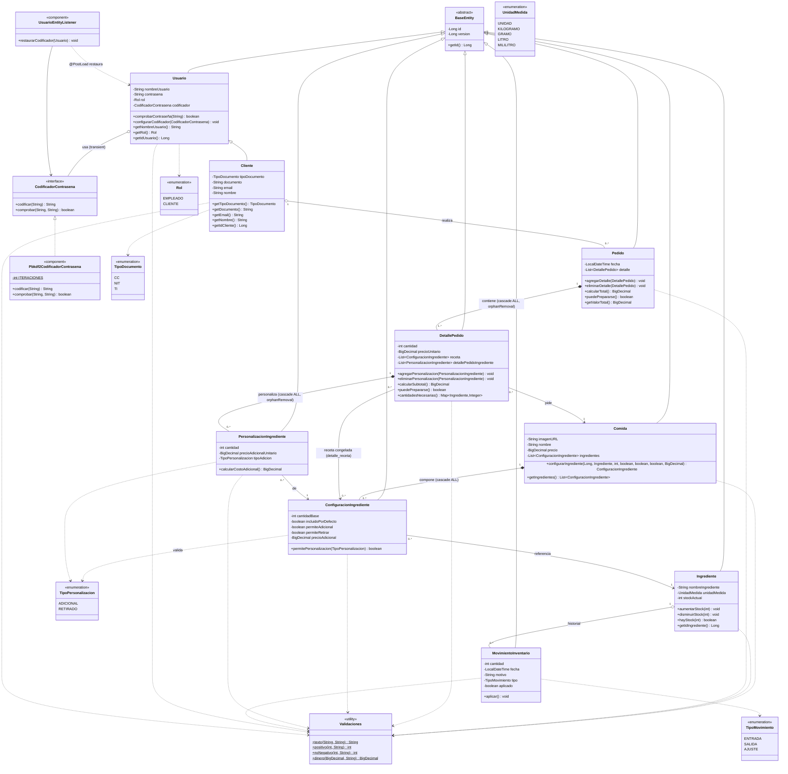

# Diagrama de clases

Generado a partir del codigo fuente en `backend/src/main/java/com/gfc` (paquetes `domain.model`,
`domain.port` e `infrastructure.security`). Incluye unicamente clases realmente implementadas;
no hay controladores, servicios de aplicacion ni repositorios todavia.

## Lectura del diagrama

- **Herencia**: `Cliente` extiende `Usuario`, que extiende la superclase mapeada `BaseEntity` (id + version, bloqueo optimista). El resto de entidades tambien hereda de `BaseEntity`.
- **Composicion fuerte (`*--`)**: `Pedido` posee sus `DetallePedido` y cada `DetallePedido` posee sus `PersonalizacionIngrediente` — se crean/eliminan junto al propietario (`cascade = ALL`, `orphanRemoval = true`). `Comida` posee sus `ConfiguracionIngrediente` de forma similar, pero sin `orphanRemoval`.
- **Agregacion (`o--`)**: `Cliente` con sus `Pedido` e `Ingrediente` con sus `MovimientoInventario` — existen independientemente uno del otro; no se cascada su ciclo de vida desde el "todo", y el "todo" tampoco es dueño exclusivo de esos hijos.
- **Asociacion simple (`-->`)**: referencias de solo lectura sin due;o del ciclo de vida, por ejemplo `DetallePedido --> Comida` o `ConfiguracionIngrediente --> Ingrediente`.
- **Dependencia (`..>`)**: uso puntual de un tipo (enumerados, `Validaciones`), sin mantenerlo como atributo permanente.
- **`Validaciones`** es una clase de utilidad *package-private* (no expuesta fuera de `domain.model`) usada por casi todas las entidades para centralizar las reglas de validacion (texto obligatorio, enteros positivos/no negativos, montos en COP con `DECIMAL(19,2)`).
- **Puerto y adaptador**: `CodificadorContrasena` es un puerto del dominio (no depende de ninguna libreria de seguridad); `Pbkdf2CodificadorContrasena` es el unico adaptador, registrado como `@Component` de Spring e inyectado en `Usuario` y en `UsuarioEntityListener` (que restaura el codificador transitorio tras `@PostLoad`, ya que Hibernate no serializa campos `@Transient`).
